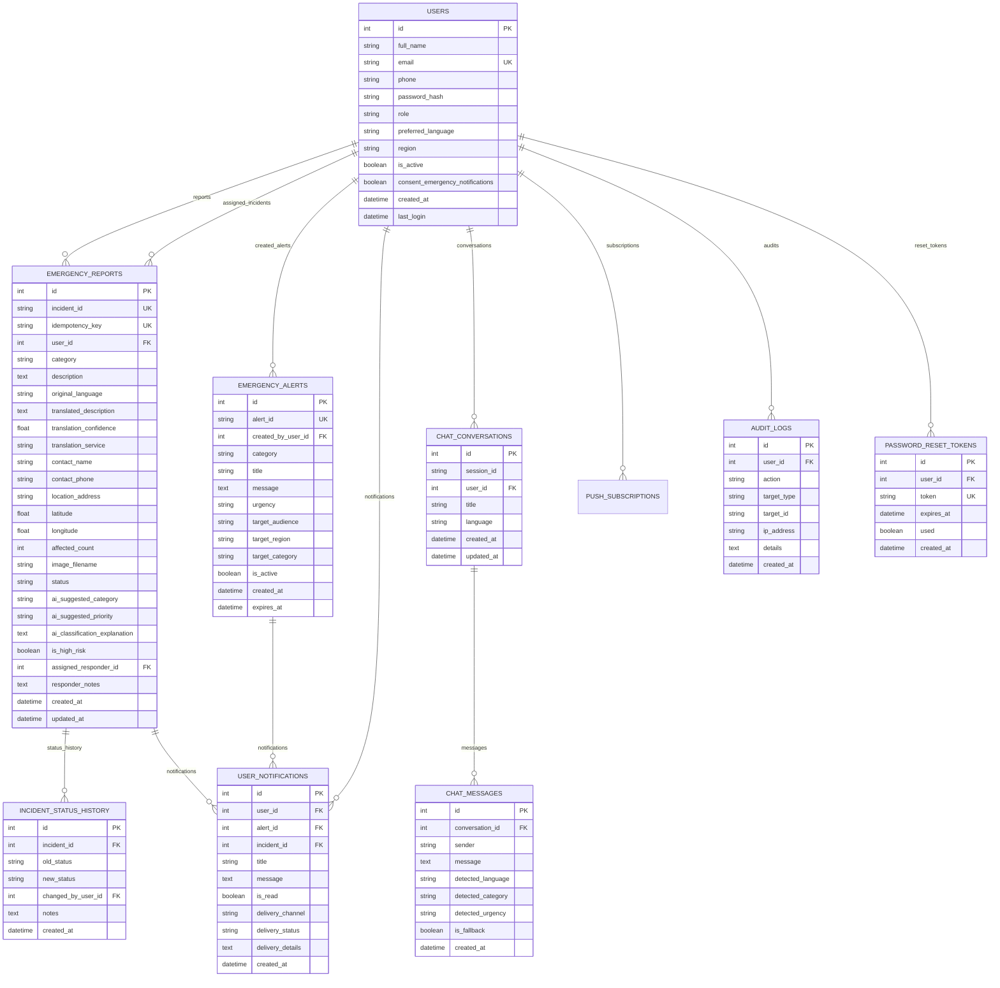

# ResQAI: Database Architecture & Design Document

---

## 1. Entity-Relationship Overview

The ResQAI relational database schema is designed using SQLAlchemy ORM. It supports local zero-configuration SQLite for demonstrations and is structured with ANSI-compliant data types to seamlessly migrate to PostgreSQL or MySQL in production environments.

---

## 2. Table Specifications

### 2.1 `users`
| Column | Type | Constraints | Description |
|---|---|---|---|
| `id` | Integer | Primary Key, Auto-increment | Internal unique user identifier |
| `full_name` | String(100) | NOT NULL | User's legal or reported name |
| `email` | String(120) | NOT NULL, UNIQUE, Index | Authentication credential (lowercase) |
| `phone` | String(20) | Nullable | Contact phone number for responders |
| `password_hash` | String(256) | NOT NULL | Cryptographic PBKDF2/SHA256 password hash |
| `role` | String(20) | NOT NULL, Default: 'user' | Access control level (`user`, `responder`, `admin`) |
| `preferred_language` | String(10) | NOT NULL, Default: 'en' | Preferred UI & communication language |
| `region` | String(100) | Nullable | Geographic district for targeted alerts |
| `is_active` | Boolean | NOT NULL, Default: True | Account enable/disable switch |
| `consent_emergency_notifications` | Boolean | NOT NULL, Default: True | Opt-in consent for emergency alerts |
| `created_at` | DateTime | NOT NULL, UTC | Timestamp of account registration |
| `last_login` | DateTime | Nullable, UTC | Timestamp of last authenticated session |

### 2.2 `emergency_reports`
| Column | Type | Constraints | Description |
|---|---|---|---|
| `id` | Integer | Primary Key, Auto-increment | Internal integer ID |
| `incident_id` | String(30) | NOT NULL, UNIQUE, Index | Clean public ID format (e.g. `INC-20261025-XXXX`) |
| `idempotency_key` | String(64) | Nullable, UNIQUE, Index | UUID generated by client for offline deduplication |
| `user_id` | Integer | Foreign Key (`users.id`), Nullable | Submitting user ID (nullable for walk-ins) |
| `category` | String(50) | NOT NULL | Incident category (medical, fire, flood, etc.) |
| `description` | Text | NOT NULL | Raw emergency description submitted by citizen |
| `original_language` | String(10) | NOT NULL, Default: 'en' | Language code of the citizen's original text |
| `translated_description`| Text | Nullable | English translation for responder coordination |
| `translation_confidence`| Float | Nullable | Algorithmic confidence score (0.0 to 1.0) |
| `location_address` | String(255) | Nullable | Physical street address or village landmark |
| `latitude` | Float | Nullable | GPS latitude coordinate |
| `longitude` | Float | Nullable | GPS longitude coordinate |
| `affected_count` | Integer | NOT NULL, Default: 1 | Number of individuals endangered |
| `image_filename` | String(255) | Nullable | Secure UUID filename of uploaded scene photo |
| `status` | String(30) | NOT NULL, Default: 'Submitted' | `Submitted`, `Under Review`, `Assigned`, `In Progress`, `Resolved`, `Closed` |
| `ai_suggested_priority` | String(20) | NOT NULL, Default: 'Medium' | AI Urgency triage tier (`Critical`, `High`, `Medium`, `Low`) |
| `is_high_risk` | Boolean | NOT NULL, Default: False | Flag indicating severe life hazard requiring instant review |
| `assigned_responder_id` | Integer | Foreign Key (`users.id`), Nullable | Assigned rescue coordinator or team lead |
| `responder_notes` | Text | Nullable | Real-time operations log from field responders |

---

## 3. Offline Idempotency & Data Deduplication

In disaster conditions with flapping network connections, mobile devices frequently re-transmit queued reports. To prevent creating duplicate incidents, every offline report is assigned an `idempotency_key` (UUID v4) on the client side:

1. When `/api/sync/report` receives a payload, it performs an indexed lookup on `EmergencyReport.idempotency_key`.
2. If a report with that key already exists, the server immediately returns `HTTP 200 OK` with `is_duplicate: True` and the existing `incident_id`.
3. If no matching record exists, the server commits the transaction and returns `HTTP 201 Created`.
4. This ensures strict **at-most-once** incident record generation.
