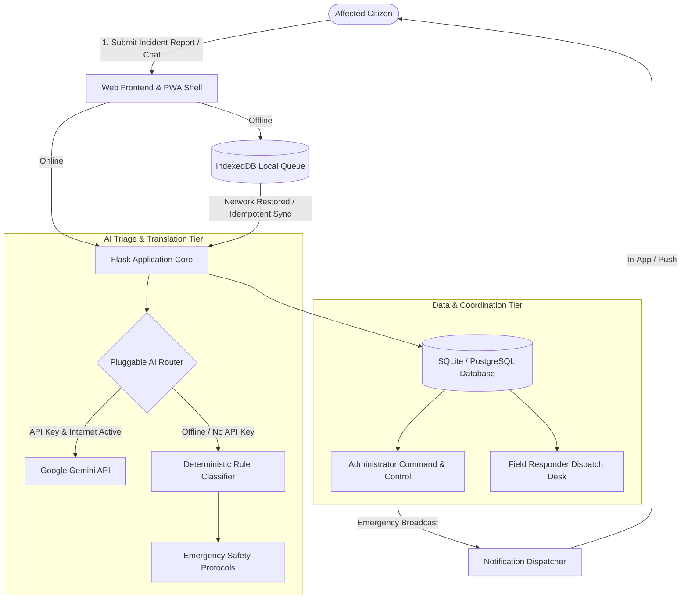

# ResQAI: AI-Powered Multilingual Emergency Triage & Offline Disaster Support System

**Diploma in Computer Engineering — Final Year Capstone Project**

---

## 1. Executive Summary

During acute disaster situations—such as flash floods, earthquakes, structural fires, and cyclones—traditional telecommunication networks frequently suffer severe degradation or outright infrastructure collapse. Concurrently, emergency response helplines experience massive call congestion, and affected citizens struggling with language barriers cannot easily articulate their location or medical urgency.

**ResQAI** is a resilient, full-stack emergency communication and disaster support web platform designed to solve these mission-critical challenges. ResQAI provides:

1. **Multilingual Inclusivity:** Native intake across 14 regional and global languages (including Hindi, Marathi, Bengali, Tamil, Telugu, Gujarati, Kannada, Malayalam, Punjabi, Urdu, Spanish, French, Arabic, and English) with full Right-to-Left (RTL) layout support.
2. **Zero-Downtime Triage:** A pluggable AI triage system leveraging Google Gemini when connectivity permits, backed by an instant, deterministic rule-based emergency triage and safety guidance engine that operates offline without API dependencies.
3. **Offline-First Resilience:** Progressive Web App (PWA) architecture utilizing Service Workers and client-side IndexedDB to store and queue draft emergency reports during network outages, synchronized automatically using UUID idempotency keys to prevent duplicate records upon reconnect.
4. **Targeted Emergency Broadcasts:** Multi-channel alerting allowing authorized coordinators to dispatch geographically targeted or hazard-specific emergency warnings with audited delivery tracking.
5. **Operational Field Responders:** A dedicated responder desk enabling rescue personnel to review mapped GPS coordinates, original citizen messages, English translations, and maintain live status logs.

---

## 2. System Architecture

ResQAI follows a modular MVC architecture using Flask, SQLAlchemy ORM, Bootstrap 5, and modern web standards:

---

## 3. User Roles & Access Control

ResQAI implements strict Role-Based Access Control (RBAC):

1. **Citizen (`user`):**
   - Can submit emergency incident reports with optional geolocation coordinates and scene photos.
   - Can converse with ResQAI Assistant for verified first-aid and survival instructions.
   - Can access their own personal report history and status progression timeline.
   - Access to other users' private reports is strictly forbidden (enforces HTTP 403 Forbidden).
   - Receives in-app disaster alerts and localized weather advisories.

2. **Field Responder (`responder`):**
   - Receives a real-time operational dashboard of assigned emergency cases.
   - Can claim unassigned incidents from the emergency triage pool.
   - Views mapped GPS coordinates with Google Maps deep-links.
   - Reviews original citizen reports alongside automated English translations.
   - Updates operational status (`Assigned`, `In Progress`, `Resolved`, `Closed`) and logs responder notes.

3. **System Administrator (`admin`):**
   - Full command and control overview across all incidents, alerts, users, and audit logs.
   - Multi-channel Emergency Alert creation with audience targeting (Global, Regional, Category-based).
   - User account administration and responder role delegation.
   - Dynamic Chart.js analytics tracking incidents by category, status, urgency, and language.
   - CSV dataset export for disaster management reporting.
